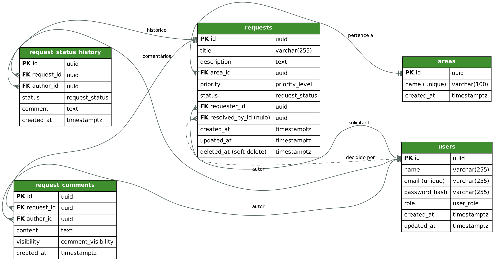

# Gestão de Solicitações Internas (protótipo)

Protótipo web para registrar, consultar e decidir solicitações internas, com três perfis: solicitante, atendente e supervisor.

**Stack:** Next.js 15 (App Router) + React 19 · Nest.js 11 (TypeScript) · PostgreSQL 16 · TypeORM · Docker

## Status da entrega

| Parte | Situação |
|---|---|
| Backend (API, auth, RBAC, validação, erros, migrations, seed) | Implementado e testado |
| Frontend Next.js (login, dashboard com período e gráfico, listagem em lista ou kanban, nova solicitação e detalhe em popup ou tela cheia, layout para celular) | Implementado e testado |
| Testes automatizados: 52 unitários + 21 de integração (backend), 36 (frontend) | Implementado |
| Testes de segurança e robustez (bateria de ataque, achados corrigidos) | Executado; resultado em [Testes de segurança e robustez](#testes-de-segurança-e-robustez) |
| Docker (Postgres + backend + frontend) | Implementado |
| Integração com sistema externo após aprovação | Não implementada (desenho em [docs/consideracoes-arquiteturais.md](docs/consideracoes-arquiteturais.md)) |
| Recuperação de senha | Pendente |

## Funcionalidades

| Enunciado | Como ficou |
|---|---|
| 4.1 Cadastro | Título, descrição (aceita markdown) e área. Solicitante e data vêm do sistema; o status inicial é sempre "Aberta". A prioridade é definida pela equipe (nasce "Média"). |
| 4.2 Consulta | Lista paginada (20, 50 ou 100 por página) ou kanban. Busca por texto sem diferenciar acento e maiúsculas, filtros por status, prioridade e área, ordenação por data. |
| 4.3 Análise e decisão | Atendente e supervisor mudam o status no detalhe ou arrastando o card no kanban, sempre com comentário. O histórico guarda autor, data e comentário de cada mudança; uma solicitação decidida pode ser reaberta. |
| 4.4 Dashboard | Total, abertas, em análise, aprovadas e rejeitadas; gráfico de rosca por status; barras por prioridade; filtro por período. |
| Além do pedido | Edição de título, descrição e área no detalhe (equipe sempre; solicitante enquanto aberta), comentários internos e externos, triagem de prioridade, exclusão lógica pelo supervisor, detalhe e cadastro em popup, layout para celular. |

Permissões por perfil (a regra vale na API, não só na tela):

| | Solicitante | Atendente | Supervisor |
|---|---|---|---|
| Vê solicitações | só as próprias | todas | todas |
| Cria solicitação | sim | sim | sim |
| Edita título, descrição e área | a própria, enquanto aberta | sim | sim |
| Define prioridade | não | sim | sim |
| Muda status | não | sim | sim |
| Comentário interno | não (nem vê) | sim | sim |
| Exclui | não | não | sim |

## Como executar

Pré-requisitos: Docker e Docker Compose, com as portas 3000 (frontend), 3001 (API) e 5432 (Postgres) livres.

```bash
docker compose up --build
```

Isso sobe o Postgres, aplica as migrations, roda o seed e inicia a API (`http://localhost:3001`) e o frontend (`http://localhost:3000`). Abra o frontend no navegador e entre com um dos usuários de teste abaixo.

Sem Docker (Node 22 + Postgres 16 local):

```bash
# terminal 1: API
cd backend
cp .env.example .env
npm install
npm run migration:run
npm run seed
npm run start:dev

# terminal 2: frontend
cd frontend
npm install
API_URL=http://localhost:3001 npm run dev
# no PowerShell: $env:API_URL="http://localhost:3001"; npm run dev
```

### Configuração

Com Docker, nada precisa ser configurado: o `docker-compose.yml` já define as variáveis com valores de exemplo. Sem Docker, o backend lê `backend/.env` (copiado de `.env.example`) e o frontend lê as variáveis do ambiente.

| Variável | Onde | Padrão de exemplo | Para que serve |
|---|---|---|---|
| `DB_HOST`, `DB_PORT`, `DB_USER`, `DB_PASSWORD`, `DB_NAME` | backend | `localhost`, `5432`, `requests` | Conexão com o Postgres |
| `JWT_SECRET` | backend | `troque-este-segredo-em-producao` | Assinatura do token (obrigatória; trocar fora da avaliação) |
| `JWT_EXPIRES_IN` | backend | `8h` | Validade do token |
| `PORT` | backend | `3001` | Porta da API |
| `CORS_ORIGIN` | backend | `http://localhost:3000` | Origem autorizada a chamar a API |
| `API_URL` | frontend | `http://localhost:3001` | Endereço da API, usado pelo servidor do Next |
| `COOKIE_SECURE` | frontend | `false` | `true` atrás de HTTPS, para o cookie de sessão só trafegar cifrado |

### Usuários de teste (criados pelo seed)

Senha de todos: `Senha@123` (apenas para avaliação).

| E-mail | Papel |
|---|---|
| solicitante@sicredi.test | requester |
| atendente@sicredi.test | agent |
| supervisor@sicredi.test | supervisor |

### Testes

```bash
cd backend
npm test            # unitários (transição de status, guard de papéis, validação dos DTOs, login)
npm run test:e2e    # integração contra Postgres real (precisa de migration + seed aplicados e JWT_SECRET definido)

cd ../frontend
npm test            # validação (Zod), regras de status, formulários de decisão e de edição, kanban (arrastar), período do dashboard e endereços da listagem
```

## API

Todas as rotas, exceto `POST /auth/login`, exigem `Authorization: Bearer <token>`.

| Método | Rota | Quem pode | Descrição |
|---|---|---|---|
| POST | /auth/login | público | Retorna JWT e dados do usuário. Limite de 10 tentativas por minuto por IP + e-mail (depois, 429) |
| GET | /auth/me | autenticado | Usuário do token |
| GET | /areas | autenticado | Áreas disponíveis |
| POST | /requests | autenticado | Cria solicitação (status `open`; solicitante vem do token). `priority` só pode ser enviada por atendente/supervisor; sem ela, nasce `medium` |
| GET | /requests | autenticado | Lista com filtros `status`, `priority`, `areaId`, `search`, `searchIn`, `order`, paginação `page` e `limit` (20/50/100) |
| GET | /requests/:id | autenticado | Detalhe com histórico de status e comentários |
| PATCH | /requests/:id | dono (se `open`) ou atendente/supervisor | Edita título, descrição e área; prioridade só atendente/supervisor (403 para o solicitante) |
| PATCH | /requests/:id/status | atendente, supervisor | Muda status com comentário obrigatório |
| POST | /requests/:id/comments | autenticado | Comentário sem mudar status (interno ou externo) |
| DELETE | /requests/:id | supervisor | Exclusão lógica (soft delete) |
| GET | /dashboard | autenticado | Total, por status e por prioridade, agregado no banco. Período opcional `from`/`to` (AAAA-MM-DD, sobre a data de criação, dia no fuso de Brasília) |

Listagem devolve `{ data, total, page, totalPages }`. Erros saem sempre como `{ statusCode, message, errorId, path, timestamp }`.

Limites de entrada: título até 255 caracteres, descrição até 10.000, comentário (livre ou de decisão) até 5.000, busca até 100, senha até 128, corpo da requisição até 100 KB (acima disso, 413). Campos de texto com apenas espaços contam como vazios.

## Decisões de modelagem



Modelo completo em `docs/modelo-dados.dbml` (cole no dbdiagram.io); a imagem acima foi exportada dele. Cinco tabelas: `users`, `areas`, `requests`, `request_status_history`, `request_comments`.

- **Área em tabela** (não enum nem texto livre): texto livre quebra a agregação do dashboard e enum exigiria deploy para criar área nova.
- **Prioridade, status, papel e visibilidade como enum nativo do Postgres**: domínios fechados.
- **Prioridade definida pela equipe**: o solicitante descreve o pedido, mas não escolhe a prioridade (todo mundo marcaria "Alta"). A solicitação nasce como "Média" e atendente ou supervisor ajustam na triagem, no detalhe. A regra fica no backend: o solicitante que envia `priority` recebe 403.
- **Histórico de status separado**: cada mudança guarda autor, data, status novo e comentário. Reabrir é só mais uma linha, sem status extra além dos quatro do enunciado.
- **Comentários soltos separados do histórico**: comunicação entre solicitante e equipe sem mudar status, com flag interno/externo.
- **Data de criação gerada pelo sistema**, imutável. `updated_at` mantido como verificação cruzada com o histórico.
- **Exclusão lógica** (`deleted_at`): preserva o dado para eventual necessidade legal (LGPD, art. 16, II) e retira da listagem e do dashboard. Expurgo definitivo por política de retenção fica fora do escopo.
- **Nomes em inglês**; camelCase no TypeScript, snake_case no Postgres (tradução feita pelo ORM em um único ponto).

## Decisões de arquitetura

- Módulos por domínio do Nest (controller → DTO → service → repositório). Sem Clean/Hexagonal: desproporcional a um protótipo.
- Regra mais crítica isolada em função pura e testada: `requests/status-transitions.ts`.
- Autenticação com JWT nativo (Passport) e senha com argon2. Papel lido sempre de dentro do token assinado, por guard global (`@Roles`).
- Solicitante só enxerga as próprias solicitações e só cria comentário externo.
- Validação com class-validator (`whitelist` + `forbidNonWhitelisted`: status e solicitante nunca vêm do corpo). Filtro global de exceções com `errorId`.
- Logs de eventos de negócio (criação, mudança de status, exclusão) em JSON.
- Endurecimento da API: `helmet` (cabeçalhos de segurança), limite de tentativas no login (`@nestjs/throttler`) e login com tempo de resposta igual para e-mail existente e inexistente. Detalhes na seção de testes de segurança.

## Decisões do frontend

- **Server Components** para dashboard, listagem e detalhe (leitura); **Client Components** só onde há interação (formulários, arrastar no kanban, popup do detalhe).
- **Filtros e paginação na URL** (`/requests?status=open&page=2`): link compartilhável e histórico do navegador funcionando. Parâmetros vazios do formulário são descartados antes de chamar a API.
- **Lista ou kanban** na página de solicitações, escolhido na própria URL (`?view=kanban`). O kanban tem uma coluna por status, com o total e os mesmos filtros da lista; cada coluna mostra até 100 cards e leva à lista quando há mais.
- **Arrastar para mudar status** no kanban, para atendente e supervisor. As colunas permitidas pelas transições ficam destacadas e as proibidas apagadas. Soltar o card abre uma janela pedindo o comentário obrigatório, e o status só muda ao confirmar, pela mesma action da tela de detalhe (a regra continua no backend). O solicitante vê o kanban, mas não arrasta.
- **Detalhe em popup**: clicar numa solicitação na lista ou no kanban abre o detalhe sobre a listagem, com rotas interceptadas do Next (`@modal/(.)requests/[id]`). A URL muda para `/requests/:id`; fechar volta para onde o usuário estava, e "Abrir em tela cheia", o acesso direto ou recarregar a página mostram a página completa.
- **Nova solicitação em popup**, pelo mesmo mecanismo do detalhe. A rota estática `@modal/(.)requests/new` existe para a interceptação de `[id]` não tratar "new" como um id. Depois de criar, a página do detalhe é carregada por inteiro.
- **Dashboard**: números por status (viram link para a lista filtrada), rosca por status e barras por prioridade, em SVG e CSS, sem biblioteca de gráficos. O filtro de período vai na URL (`/?from=...&to=...`); com período ativo, os números deixam de ser link, porque a listagem não filtra por data.
- **Celular**: os filtros ficam recolhidos atrás do botão "Filtros" (a busca continua visível), a lista vira cartões compactos e o kanban mostra uma coluna por vez, com abas por status.
- **Volta para a última listagem**: o endereço da listagem (visão e filtros) fica guardado na sessão do navegador, e o "voltar" do detalhe e o redirecionamento após excluir usam esse endereço. Só são aceitos endereços da própria listagem.
- **Token em cookie httpOnly**, lido só no servidor do Next: o JavaScript do navegador nunca enxerga o JWT. As chamadas à API saem do servidor do Next (Server Actions e Server Components).
- **Validação nas duas pontas**: Zod + React Hook Form no formulário (feedback imediato) e class-validator no backend (quem garante de verdade).
- **Cache**: os dados são por usuário (o solicitante só vê as próprias solicitações), então não uso o cache de dados compartilhado do Next, que serviria dados de um usuário a outro. As telas são renderizadas sob demanda, e toda mutação (criar, decidir, comentar, excluir) chama `revalidatePath` nas telas afetadas. A navegação entre telas usa o prefetch do `<Link>`.
- Descrição em **markdown** renderizada com `react-markdown`, que não aceita HTML cru (sem XSS pelo texto digitado).
- A lista de transições de status também existe no frontend (`src/lib/status.ts`) só para esconder opções inválidas. A regra de verdade está no backend.

## Testes de segurança e robustez

Com a aplicação na versão estável, fiz uma bateria de testes tentando quebrá-la, como um testador mal-intencionado: caracteres inválidos, tipos errados, textos gigantes, tokens forjados, tentativa de acessar dados de outros usuários e de burlar regras de negócio. Foram cerca de 190 verificações contra a API e o frontend rodando, mais a inspeção do navegador para XSS. A bateria foi executada com apoio de IA, por scripts descartáveis que não estão versionados; o que ficou no repositório são os testes de regressão (unitários e de integração).

**O que resistiu:** token JWT forjado (algoritmo `none`, papel alterado, assinatura trocada, expirado); SQL injection e payloads de operador no login e na busca; acesso a solicitações de outros usuários (leitura, edição, comentário, listagem, busca e dashboard); mudança de status e exclusão por quem não pode; comentário interno visível ao solicitante; envio de campos proibidos no corpo (`status`, `requesterId`, `resolvedById`); XSS (script, `onerror`, `javascript:` e iframe no título, na descrição e nos comentários aparecem como texto e nada executa); solicitação excluída (404 em todas as operações); 10 decisões simultâneas na mesma solicitação (uma aceita, nove recusadas, histórico consistente); CORS com origem não autorizada.

**O que encontrei e corrigi:**

| # | Achado | Gravidade | Correção | Teste de regressão |
|---|---|---|---|---|
| 1 | O login levava ~96 ms com e-mail existente e ~15 ms com inexistente, o que permitia descobrir quais e-mails existem pelo tempo | Média | O argon2 passa a rodar sempre, com um hash descartável quando o e-mail não existe. Depois: ~94 ms contra ~110 ms | `auth.service.spec.ts` |
| 2 | Sem limite de tentativas no login (40 senhas erradas em 3 s, todas processadas) | Média | `@nestjs/throttler`: 10 tentativas por minuto por IP + e-mail (429 depois disso) e teto geral de 600 por minuto por IP | e2e (429 sem travar outra conta) |
| 3 | Campos obrigatórios aceitavam apenas espaços pela API: título vazio gravado, descrição e comentário em branco, e **decisão de status sem comentário**. O frontend já barrava, a API não | Média | `trim` antes da validação nos DTOs (`common/text.decorators.ts`) | unitário dos DTOs + e2e |
| 4 | Erro 500 onde deveria ser erro do cliente: corpo acima de 100 KB, `areaId` inexistente (criação e edição), caractere nulo no texto, `title: null` na edição, `page` enorme | Baixa | 413 para corpo grande (filtro de exceções), checagem da área antes de gravar (400), validação do caractere nulo, `null` rejeitado no PATCH, `page` com máximo | unitário + e2e |
| 5 | Texto sem tamanho máximo (descrição e comentário aceitavam 100 KB) | Baixa | Máximos de 10.000 e 5.000 caracteres, busca com 100 | unitário + e2e |
| 6 | A busca tratava `%` e `_` como curingas do `ILIKE`: pesquisar `%` devolvia tudo | Baixa | Os caracteres são escapados na consulta | e2e |
| 7 | Sem cabeçalhos de segurança (`X-Powered-By: Express`, sem `nosniff`, HSTS, `X-Frame-Options`) | Baixa | `helmet` na API; cabeçalhos no `next.config.mjs` (`X-Frame-Options`, `nosniff`, `Referrer-Policy` e `frame-ancestors 'none'`) | e2e (API) |
| 8 | `limit=20abc` e `page=1.5` eram aceitos (`parseInt` lê só o prefixo) | Baixa | `Number()` com validação de inteiro | unitário + e2e |

Depois das correções, repeti a mesma bateria contra o sistema rodando e os pontos acima deixaram de ocorrer.

**Não corrigido ou fora do que foi testado:**

- O limite de tentativas usa memória do processo: reinicia junto com a API e não é compartilhado entre instâncias. Em produção seria preciso um armazenamento compartilhado (Redis). Como o frontend chama a API de um único servidor, o limite do login conta por IP + e-mail para não bloquear todos os usuários juntos; isso não limita quem troca de e-mail a cada tentativa, e o teto geral por IP cobre só em parte.
- O CSP do frontend cobre apenas `frame-ancestors`. Uma política completa exigiria nonces por requisição por causa dos scripts inline do Next.
- `npm audit` no frontend aponta 2 avisos (PostCSS, dependência embutida no Next) cuja correção exige o Next 16, uma troca de versão major que não fiz neste prazo. No backend não há avisos nas dependências de produção.
- Não foram testados: cookie com `Secure` sob HTTPS (o ambiente local é HTTP), carga e desempenho sob volume, e um teste dedicado de CSRF.

## Premissas e limitações

- Sem recuperação de senha nem cadastro de usuários (usuários vêm do seed).
- Busca textual usa `ILIKE` + `unaccent`; para volume grande, evoluir para índice trigram ou full-text.
- Quem pode reabrir uma solicitação decidida não é restrito além do papel atendente/supervisor.
- A mudança de prioridade não entra no histórico (que registra só status); fica registrada apenas a data de atualização.
- Não há teste automatizado de ponta a ponta no navegador versionado no repositório. O fluxo completo (login, criar, decidir, comentar, excluir) foi conferido manualmente em navegador real durante o desenvolvimento.
- Interface em português, sem internacionalização, e sem tela de administração de usuários e áreas (vêm do seed).
- O arrastar do kanban usa o recurso nativo do navegador, que não funciona por toque: no celular, a mudança de status é feita no detalhe da solicitação. Também não há como mudar status pelo teclado no kanban; o caminho acessível é o formulário do detalhe.
- Segurança: segredo JWT e senha do banco vêm de variáveis de ambiente com valores de exemplo. Em produção precisariam ser trocados e `COOKIE_SECURE=true` ativado atrás de HTTPS.

## Evolução da solução

As perguntas do item 8.2 (evolução da solução e integração com sistemas externos) e o item 11 (o que foi entregue, o que ficou pendente, critérios de priorização e próximos passos) estão respondidos em [docs/consideracoes-arquiteturais.md](docs/consideracoes-arquiteturais.md). Em resumo, os próximos passos seriam:

- **Atribuição explícita de responsável** antes da decisão (hoje `resolved_by` só registra quem decidiu).
- **Integração com sistema corporativo após aprovação**: padrão outbox (tabela de eventos gravada na mesma transação da mudança de status, despachada por job com retry e backoff e chave de idempotência), para que falha do sistema externo não afete a experiência do usuário e haja rastreabilidade.
- Observabilidade (métricas, tracing), cache de leitura do dashboard, índices adicionais conforme volume, filas para processamento assíncrono.
- Recuperação de senha, SSO corporativo.
